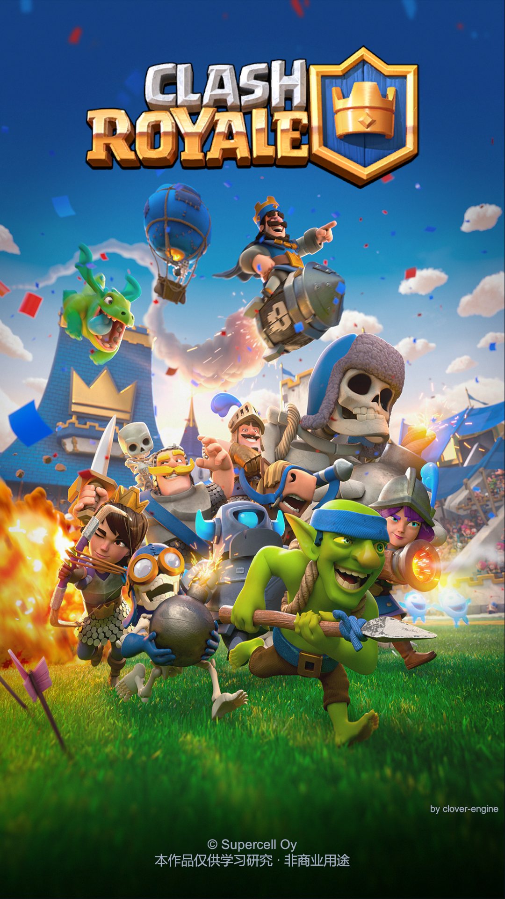

# Clover × Clash Royale

用 [Clover 客户端引擎](https://github.com/qw576483/clover-client-unity-engine) 复刻《皇室战争》的工程。

**交付范围**：竖版（设计画布 **1080×1920**）的 1v1 实时对战，**权威服务器 + 房间制**（大厅 → 房间列表 → 对局）；核心对局链路（启动 → 登录 → 创角 → 主菜单 → 房间/人机 → 对局 → 结算 → 回主菜单）完整可玩。
用户额外点名（原版没有）：**人机 PK**、**创建房间 + 房间列表加入**、**20 张典型卡**。

## 实机画面

> 以上是本工程的**实机帧**（1080×1920 竖版）。发布脚本 = `tools/probes/readme-shots.ps1`（映射表 `tools/readme-shots.map.tsv`）；成品图随仓库保存在 `策划/实机图/`。

## 怎么玩

1. **中间件**：`clover-server-tools/windows-env/core/env.exe start`（etcd / nats / redis / mysql 四件套；`env.exe info` 看就绪状态）；
2. **服务端**：`cd server`，`clover-cr.exe -config configs/all`（或 `go run . -config configs/all`）；
3. **客户端**：Unity **6000.6** 打开 `client/`，进 Play；
4. **开一局**：登录（或点「注册新账号」）→ 主菜单「战斗」→「人机对战」；对局内**按住底部手牌拖到己方半场**松手出牌，拖法术卡可看落点范围圈。

> 编辑器用本机 **Unity Hub** 打开；引擎依赖由 UPM 按 `client/Packages/manifest.json` 解析（本机联调引擎源码时指向 `file:../../../clover-client-unity-engine`）。

## 工程结构

| 路径 | 内容 |
|---|---|
| `client/` | Unity 工程（复刻本体；`Library/` `Temp/` `Logs/` 等生成物不入库） |
| `server/` | Go 服务端（本工程是**联机**形态：权威服务器 + 房间，**不降级为单机**） |
| `策划/` | 复刻规格（`策划案/皇室战争参考规格.md`）、对照表、客户端架构（`client-architecture.md`）与 API 参考、素材调研、原版 UI 素材索引、单位帧段表、实机图 |
| `tools/` | 判据与工具（`probes/` 探针与量法脚本） |
| `原版资源/` | 原版素材与逆向产物（**不随仓库分发**，见 [`LICENSE`](LICENSE)） |

## 声明

本项目**仅供技术交流与学习**，禁止用于任何商业用途（第三方素材声明详见 [`LICENSE`](LICENSE)）。

## 相关仓库

| 仓库 | 说明 |
|---|---|
| [clover-client-unity-engine](https://github.com/qw576483/clover-client-unity-engine) | 客户端引擎（本工程的运行底座） |
| [clover-server-engine](https://github.com/qw576483/clover-server-engine) | 服务端引擎（`server/` 的底座） |
| [clover-tools](https://github.com/qw576483/clover-tools) | 打表工具 |
| [clover-ai-skill](https://github.com/qw576483/clover-ai-skill) | AI 交付 skill（本工程按它的规范做） |
| [clover-doc](https://github.com/qw576483/clover-doc) | 框架文档 |

> 从没用过 Clover？先看 [新手指南：用 AI 从零做一个 Clover 游戏](https://github.com/qw576483/clover-doc#beginner-guide)。
